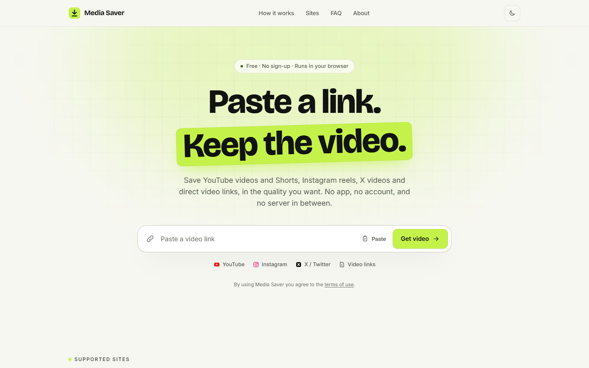

📥 Media Saver




Media Saver is a simple and fast web application for saving YouTube videos,
Instagram reels, Twitter/X videos and videos from direct links. It is a static React app —
there is no backend: everything runs in the browser.

## ✨ Features

Download YouTube videos up to 4K, or their audio as MP3

Download public Instagram reels and video posts as MP4

Download Twitter/X videos in every quality the tweet offers

Download videos from direct links (e.g. a link ending in `.mp4`)

Light and dark themes, built for phones and computers

## 🚀 Tech Stack

React 18, React Router, Tailwind CSS and Vite. Headings use Bricolage
Grotesque and body text uses Inter, both bundled from Fontsource, so no font
request leaves the site.

**Twitter/X** lookups use the public [fxtwitter](https://github.com/FixTweet/FxTwitter)
API, with vxtwitter as a fallback. Both allow cross-origin requests, so the
browser calls them directly.

**Instagram** only lets instagram.com read its pages, so reels are looked up
through the Media Saver bookmark clicked in an Instagram tab, the same relay
YouTube uses (`client/src/instagram.js`). It reads the post's embed page, which
carries the video's details on phones and computers, and falls back to the full
reel page, which carries them for computers only. Both requests ask for HTML and
carry no cookies, so they see what a logged-out visitor sees and private reels
are out of reach. The video file is on Instagram's CDN, which allows cross-origin reads,
so the site downloads it directly. Instagram offers a reel as one file with
sound at up to 720p. Its higher qualities come as separate video and audio
streams, which the site doesn't merge. The userscript doesn't cover Instagram.

**YouTube** only lets youtube.com read its API and video CDN, so a web page
can't fetch them itself. Visitors pick one of two helpers, which speak the same
`postMessage` protocol (`client/src/youtube/bridge.js`) and only ever request
`youtube.com` / `googlevideo.com`, from the visitor's own connection, without
cookies:

- **Bookmarklet — the main path, nothing to install.** Visitors drag the
  *Media Saver* button to their bookmarks bar once, then click it on any
  YouTube page. It opens the site with `?relay=<youtube origin>`, plus
  `&url=<video>` on a video page, and performs the site's requests from the
  YouTube tab, where code runs as youtube.com
  (`client/src/youtube/bookmarklet.js`). While the YouTube tab stays open, the
  site tab it opened downloads any YouTube link pasted into it. A visitor who
  pastes a YouTube link before connecting gets the one-time setup steps and an
  *Open this video on YouTube* button.
- **Android.** Phones have no bookmarks bar, so on Android the setup steps
  offer *Copy bookmark code* instead: visitors save it as a bookmark's address
  and run it by typing its name in Chrome's address bar. They paste the video's
  m.youtube.com link into the address bar, which keeps it out of the YouTube
  app. On m.youtube.com, `www.youtube.com` is a different origin whose session
  data YouTube won't share, so `bridge.js` sends those requests to the mobile
  host instead. That fix lives in the site, so existing bookmarks pick it up.
- **Setup animations.** The setup panel shows a looping GIF of the steps for
  the site the link is from, YouTube or Instagram, in a desktop or an Android
  version. The Instagram ones also show that no login is needed. The home
  page's bookmark section has a switch between the two sites. The GIFs live in
  `client/src/assets/guides/` and are drawn from the mock-up scenes in
  `client/guides/`. After changing a scene, run `npm i -D puppeteer-core`
  once, then `node guides/make-gifs.mjs` from `client/`; add scene names such
  as `instagram-desktop-bookmark` after `guides` to render only those. It
  needs Google Chrome and ffmpeg installed.
- **Userscript — optional, under "Advanced".** The *Media Saver helper* for
  Tampermonkey / Violentmonkey runs on this site and performs requests with
  `GM_xmlhttpRequest`, so visitors can paste links without visiting YouTube.
  Chrome 138+ runs userscripts only after the visitor switches on the manager's
  *Allow User Scripts* toggle (Developer Mode before 138). YouTube's API refuses
  requests that carry an extension's `Origin` header, so test this path with a
  real userscript manager before relying on it.

The site does everything else:

- [YouTube.js](https://ytjs.dev) looks up the streams using the `VISIONOS`
  client, the one that currently returns downloadable URLs without a
  proof-of-origin token (`client/src/youtube/youtube.js`).
- Video and audio download in parallel 8 MB chunks and are merged in the
  browser with FFmpeg.wasm (`client/src/Components/YTClientDownloader.jsx`).
  The FFmpeg core loads from unpkg: its 32 MB `.wasm` is over Cloudflare
  Pages' 25 MiB per-file limit.
- The helper also adds a **Download** button on YouTube video pages that
  opens the video on the site.

The helper source is `client/userscript/media-saver.user.js`. The build fills
in the site's address and publishes it at `/media-saver.user.js` (see
`vite.config.js`). Bump its `@version` when you change it so installed copies
update.

> Facebook is not supported: its pages and CDN block cross-origin requests
> too, and nothing extracts it in the browser yet.
>
> Very long or 4K videos can exceed the browser's memory while merging, since
> FFmpeg.wasm holds the whole file in memory.

## 🎨 Design

Colors are CSS variables in `client/src/index.css`, one set for light mode and
one for dark, exposed to Tailwind in `client/tailwind.config.js` as classes such
as `bg-card`, `text-muted`, `border-line` and `bg-accent`. Use those instead of
raw Tailwind colors so both themes stay in step. Shared pieces live in
`client/src/Components/`: `ui.jsx` (alerts, headings, site marks), `icons.jsx`,
`MediaResult.jsx` (the result card, quality picker and progress bar) and
`Bookmark.jsx` (the bookmark button, copy button and setup steps).

## 📋 Prerequisites

- **Node.js** 18+

## 🚀 How to Run the App

### 1. Clone the repository

```bash
git clone https://github.com/Akshay7623/media-saver.git
cd media-saver/client
npm install
```

### 2. Develop

```bash
npm run dev
```

Vite serves the app with hot reload on http://localhost:5173. To try YouTube
locally, paste a YouTube link and follow the bookmark steps the site shows, or
install the helper from http://localhost:5173/media-saver.user.js — the dev
copy also matches `localhost`.

### 3. Build and deploy

```bash
npm run build
```

`npm run preview` serves the build locally.

**Cloudflare Pages** — connect the repo and use these build settings:

| Setting | Value |
|---|---|
| Framework preset | React (Vite) |
| Root directory | `client` |
| Build command | `npm run build` |
| Build output directory | `dist` |

On Pages the build reads `CF_PAGES_URL` to point the helper at
`https://<project>.pages.dev` (and its preview URLs). For a custom domain, add
a `SITE_URL` environment variable, e.g. `https://example.com` — comma-separate
several; the first is used for the YouTube Download button.

The app uses client-side routes (`/about`, `/t-and-c`, `/privacy-policy`).
Pages serves `index.html` for them automatically as long as the build has no
top-level `404.html`. On other static hosts, add a rewrite of unknown paths to
`index.html`, or refreshing one of those pages returns a 404.

## ⚠️ Disclaimer

This project is for **educational purposes**. Downloading content from YouTube,
Twitter/X and similar platforms may violate their Terms of Service. Only download media
you own or have permission to save, and respect copyright holders.
